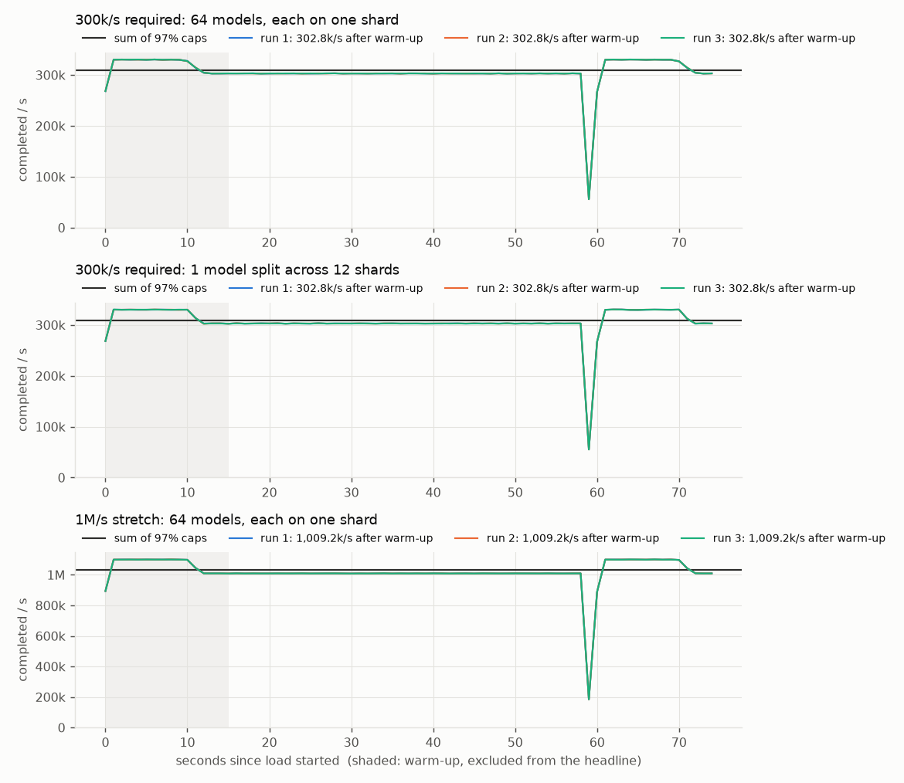

# Benchmark report

Everything in the **Measured** sections was run on one laptop and can be reproduced with the
commands at the end. The **Projection** section (10B requests/minute) is a plan built from those
measurements. It was not run.

**Machine:** Apple M3 Pro (6 performance + 6 efficiency cores), 36 GB RAM, macOS 27.0.1,
Python 3.13.3, Go 1.24.3. Nothing else heavy was running.

## Summary

| Goal | Result | Limit violations | Evidence |
|---|---|---|---|
| 50k RPM / 100M TPM capacity (Python, full system) | **48.5k/min sustained**, every minute ≥ 95.9% of the limit | 0 | [scenario 1](results/scenario1/report.md) |
| Limits change while running (Python) | Adapts with no restart, other model unaffected | 0 | [scenario 2](results/scenario2/report.md) |
| Async batch of 10k with callback (Python) | Ack 79 ms, callback after every request final, retried until delivered | 0 | [scenario 3](results/scenario3/report.md) |
| **300k req/s** required (Go hot path) | **302.8k/s** completed, both layouts, 3/3 runs | 0 | [below](#go-hot-path-measured) |
| **1M req/s** stretch (Go hot path) | **1.009M/s** completed, 3/3 runs | 0 | [below](#go-hot-path-measured) |
| Headroom (Go, limits disabled) | **≥ 11M/s** completed, 3/3 runs, on 2.3 cores | n/a | [below](#ceiling) |

"Limit violations" are counted by the provider simulator from its **own** record of calls, never from
the gateway's counters. A violation is any 60 s window over the configured limit.

## What each benchmark measures

| | Python (scenarios 1–3) | Go (300k / 1M) |
|---|---|---|
| Path | HTTP API → queue → limiter → HTTP to a separate simulator process → SQLite → callbacks | Load generator → queue → limiter → simulated provider call in the same process |
| Counts as done | Request reached a final state, stored in SQLite | Request reached a final state (succeeded or failed after retries) |
| Not included | | HTTP, JSON, persistence, callbacks |

The Go numbers measure the **core scheduling design** (queues, limiter, retries, accounting) at a
scale Python can't reach. They are not a claim that the full HTTP service does 1M/s.

## Python, full system (measured)

Details, charts and per-check evidence are in [`results/`](results/) and in [FINDINGS.md](FINDINGS.md).

- **Scenario 1:** 1,250 req/s offered (1.5× capacity) for 6 minutes against 50k RPM. The provider counted
  341,250 calls. Its busiest 60 s window was 48,668 (97.3% of the limit), with zero 429s. The 25% of
  submissions above capacity were rejected with `429` once the one-minute queue was full. Median
  end-to-end latency was 62.7 s, which is that full queue.
- **Scenario 2:** model A dropped from 30k to 5k RPM, then went back. A sent nothing for about 50 s while the
  previous minute's sends aged out, then held 97% of the new limit. Model B never fell below 96% of its limit.
- **Scenario 3:** one batch of 10,000 with injected failures. Ack in 79 ms. The callback was rejected twice
  by the receiver and delivered on the third attempt, with a summary identical to `GET /v1/batches/{id}`,
  and every request id appeared exactly once.

## Go hot path (measured)

Setup: 75 s runs, the first 15 s excluded as warm-up, 3 runs each, median reported. The provider
latency is log-normal with p50 150 ms / p99 600 ms. 2% of calls fail transiently (retried with jittered
backoff, max 5 attempts) and 1% permanently. Load is offered at 110% of the target, so the limiter is
always the thing deciding the rate.

| Benchmark | Completed / s (3 runs) | Busiest 60 s window | CPU cores busy | p50 / p99 latency |
|---|---|---|---|---|
| 300k, 64 models, each on one shard (`pinned`) | 302.8k, 302.8k, 302.8k | 97.0% of limit | 1.5 | 1.96 s / 3.15 s |
| 300k, 1 model split over 12 shards (`spread`) | 302.8k, 302.8k, 302.8k | 97.0% of limit | 1.0 | 1.98 s / 3.15 s |
| 1M, 64 models (`pinned`) | 1.009M, 1.009M, 1.009M | 97.0% of limit | 5.0 | 1.96 s / 3.15 s |



How to read these:
- **Why the runs are identical:** the limiter pins the rate. The 97% caps sum to 309k/s (or 1.03M/s), and
  the 2% of calls that are retries don't count as completions: 309k ÷ 1.02 ≈ 302.8k.
- **Every request is accounted for** in every run: generated = accepted + rejected, and accepted =
  finished + still pending at stop. About 4.5% were rejected because the load was 110% of capacity.
- **Latency is queueing.** Each lane's queue holds 2 s of its rate, so a full queue means about 2 s of waiting
  at any scale. The provider itself answers in 150 ms.
- **Spread layout:** each of 12 shards enforces a twelfth of one model's limit, with no coordination
  between them. The provider sums all 12 and checks the single global limit: 97.0%, no violation.
  The cost of a static split is that if traffic reaches the shards unevenly, a busy shard rejects
  while a quiet one has unused allowance.

### Two behaviours worth knowing about

**A once-a-minute dip and spike** (visible at t≈59–70 s in the chart). Each lane's pacer starts with one
second of credit, so for the first ~10 s sends run at the offered rate, about 7% above the cap. That uses
up part of the 60 s window early, so at t≈59 s the window is full and sends briefly stop. Then, as the
early sends expire, the pacer, which refilled during the pause, lets another burst through. The limit is
never exceeded (the provider check passes), and the 60 s average is exactly the cap, but the per-second
rate isn't flat. **Fix (not applied):** a smaller pacer burst (for example 100 ms instead of 1 s) shrinks this
tenfold. The Python gateway has the same 1 s burst, but its scenarios were less aggressive and their
trailing-60 s charts don't show it.

**Most of the CPU in limited runs is idle churn.** A CPU profile of a limited 1M/s run (`-cpuprofile`)
showed **~97% of CPU time in Go's scheduler**: threads sleeping and waking. Only ~2.5% was the engine's
own work, roughly 0.1 core per 1M req/s. The cause is that the pacer releases requests a few at a time,
so each shard naps for fractions of a millisecond and wakes constantly. **Fix (not applied):** have shards
sleep at least 1 ms and send small batches. So the "cores busy" numbers above are an upper bound on the
real cost.

### Ceiling

With the limits disabled (`-ceiling`), the engine completed **11.0M/s, all of the 11M/s offered, in 3/3
runs, on 2.3 cores**. Latency stayed at the provider's own 153 ms, so nothing queued. That's about 200 ns of
CPU per request, end to end, including generating the load.

An exploratory run at 44M/s offered collapsed: 2.25M/s completed, 88M requests in flight, the swap file
full, and 11 s of GC pauses. **The limit hit was memory, not CPU.** In ceiling mode the in-flight cap and
queue size are derived from the offered load, so a big enough overload grows memory without bound. In
every limited run they're derived from the provider limits, so memory stays bounded. The lesson for
production: an overload guard needs an absolute memory budget, not only one derived from the rate. We
report **≥ 11M/s** and don't claim a precise CPU ceiling.

## Projection: 10 billion requests per minute

10B/min ≈ **167M requests/s**. This is a plan, not a measurement.

**1. The scheduling core is not the bottleneck.** Measured at ~0.1 core per 1M req/s of real work (profile)
and ~0.2 core per 1M with everything included (ceiling run). 167M/s is on the order of 17–35 cores of
scheduling work: a handful of machines.

**2. Getting requests in and out is the bottleneck.** A realistic HTTP + JSON front end does on the order of
50k–100k requests/s per core (assumption, not measured here). That would take ~1,700–3,300 cores for
ingest alone. So:
- **Make clients batch.** One HTTP call carrying 1,000 requests divides the per-request network and parsing
  cost by ~1,000. The batch API already exists. At 10B/min it should be the main path, not the exception.
- **Put a durable log in front** (Kafka or similar), partitioned by model. Gateways consume partitions
  instead of handling every request synchronously, so a slow provider never pushes back on clients' connections.

**3. Splitting the limits across many gateways.** The spread layout already shows the mechanism: each
worker enforces a fixed share, and the shares add up to the limit. At fleet scale:
- A small **budget service** hands each gateway a lease, "you may use X RPM of model M for the next 10 s",
  sized from that gateway's recent demand. Each gateway rate limits locally with no per-request coordination.
- Leases expire, so a dead gateway's share returns to the pool. The 97% target leaves room for the slack.
- Partitioning by model means most models live on one gateway, so only hot models need splitting.

**4. State.** Store only submit and final state (as the Python version does), written in batches. At 167M/s
with ~200-byte records that's ~33 GB/s of writes per state change, spread over hundreds of log partitions
and a horizontally sharded results store (e.g. Cassandra/Scylla or object storage for batch results).

**5. Provider reality.** 10B/min exceeds any single provider account's limits by orders of magnitude, so in
practice this is thousands of (model, account, region) limit pools. The design treats each pool as a lane,
which is the same structure measured here, just more of them.

## Reproduce

From the repo root:

```bash
make setup && make test
make scenario1        # ~9 min
make scenario2        # ~10 min
make scenario3        # ~1 min
make bench-300k       # ~4 min, both layouts run separately below
make bench-300k-spread
make bench-1m         # ~4 min
make bench-ceiling    # ~4 min
make bench-charts     # rebuild docs/results/go/throughput.png from runs/go/*.json
```

Raw output goes to `runs/` (gitignored). The curated copies used in this report are in `docs/results/`.
