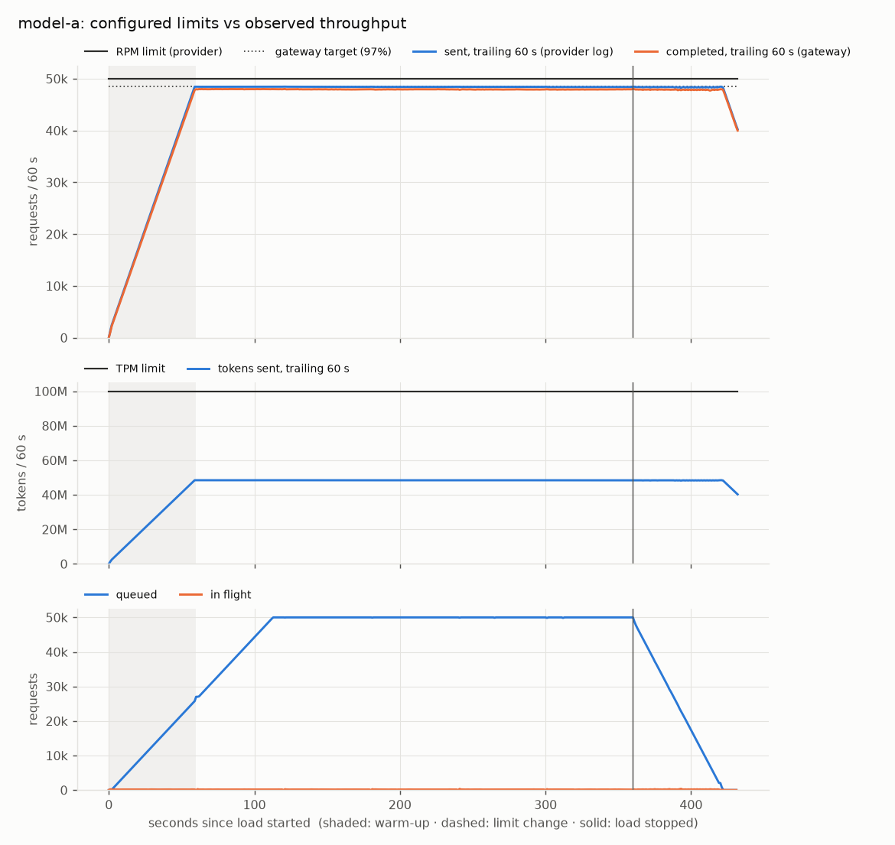
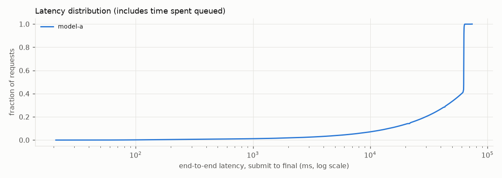

# scenario1: PASS

Reach the available provider capacity. One model at 50,000 RPM / 100M TPM; 1,000-token requests offered at 1,250 req/s (1.5x the 833/s capacity) for 6 minutes. Pass: every full minute after a 1-minute warm-up completes >= 90% of the RPM limit; no 60 s window ever exceeds either limit; every request is accounted for.

## Checks

| Check | Result | Evidence |
|---|---|---|
| `limits:model-a` | PASS | 341,250 counted calls; peak trailing-60s use 97.3% of RPM, 48.7% of TPM; 0 violations |
| `accounting` | PASS | submitted 450,000 = accepted 337,838 + rejected 112,162 (+ invalid 0, transport errors 0); snapshot_load_end: completed 287,833, waiting 50,005, expired 0, rejected 112,162, total 450,000; snapshot_drained: completed 337,838, waiting 0, expired 0, rejected 112,162, total 450,000; 337,838 request rows persisted |
| `capacity:model-a` | PASS | 5 full minutes after a 60s warm-up; lowest completed 95.9% of the RPM limit (need >= 90%) |

## Measured

- Load: 1,250 req/s offered for 360 s (achieved 1,250.0 req/s), batch size 1, 1,000 tokens per request, models {'model-a': 1}
- Requests: submitted 450,000, accepted 337,838, rejected 112,162, invalid 0, errors 0
- Completed 337,838 requests (succeeded or failed) by t=429.9 s: 785.8 requests/s (47,148/min) averaged from the start of the load to the last completion
- Submission ack latency (client side): p50 0.27 ms, p99 56.657 ms
- End-to-end latency, submit to final, all models: p50 62657.1 ms, p95 63031.5 ms, p99 63445.7 ms

| Model | Configured RPM / TPM | Peak sent in any 60 s window (requests / tokens) | Provider 429s | p50 / p95 / p99 latency (ms) |
|---|---|---|---|---|
| model-a | 50,000 / 100,000,000 | 48,668 / 48,668,000 | 0 | 62657.1 / 63031.5 / 63445.7 |

## Charts

## Assumptions (simulation, not measurement)

- The provider is simulated (`python -m simulator`): latency is log-normal fitted to the configured p50/p99, and failure outcomes are drawn deterministically from a seeded hash of each request's idempotency key and attempt.
- The provider counts **estimated** tokens when it admits a call. Rate-limited (429) calls don't use capacity.
- Limits are checked at every call the provider counted, over the trailing 60 s, against the limit in effect at that moment (docs/ARCHITECTURE.md §4.1).
- Latency is end to end: it includes time spent queued, which dominates whenever demand exceeds capacity.
- Environment: {'python': '3.13.3', 'platform': 'macOS-27.0.1-arm64-arm-64bit-Mach-O', 'machine': 'arm64', 'cpus': 12, 'processor': 'arm'}
