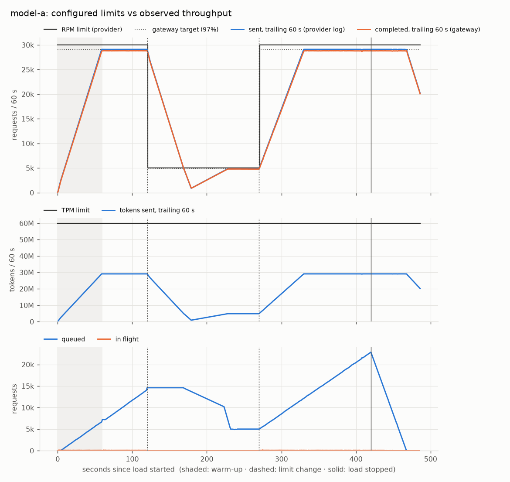
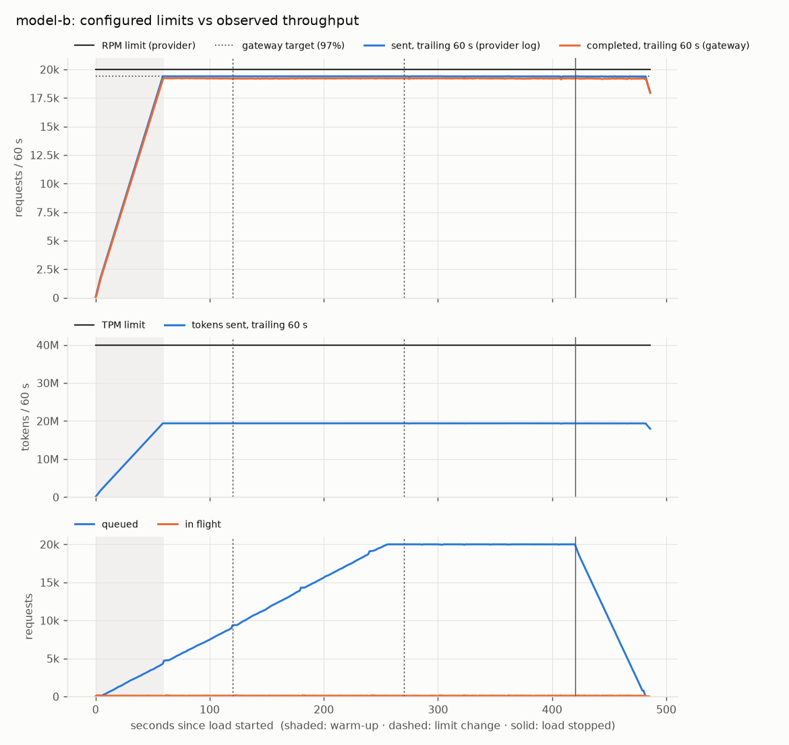
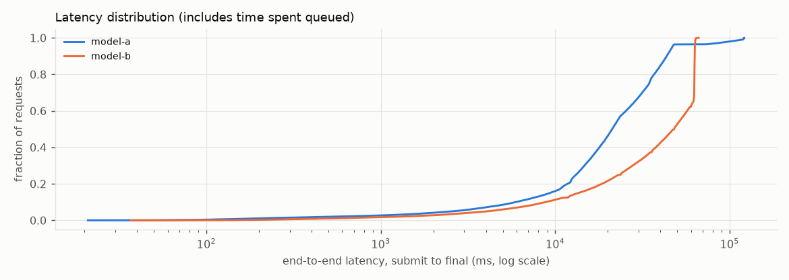

# scenario2: PASS

Different models and changing limits. Model A at 30,000 RPM / 60M TPM, model B at 20,000 RPM / 40M TPM, both offered more than their limit. At t=120 s model A drops to 5,000 RPM; at t=270 s it is restored. Model B is never changed. Pass: both models stay within their current limits at every send; model A settles at its new limit after each change with no restart; model B stays at >= 90% of its limit every minute, including while A is constrained.

## Checks

| Check | Result | Evidence |
|---|---|---|
| `limits:model-a` | PASS | 162,283 counted calls; peak trailing-60s use 97.4% of RPM, 48.7% of TPM; 0 violations |
| `limits:model-b` | PASS | 155,995 counted calls; peak trailing-60s use 97.5% of RPM, 48.8% of TPM; 0 violations |
| `accounting` | PASS | submitted 420,000 = accepted 323,985 + rejected 96,015 (+ invalid 0, transport errors 0); snapshot_load_end: completed 272,192, waiting 42,950, expired 8,843, rejected 96,015, total 420,000; snapshot_drained: completed 315,142, waiting 0, expired 8,843, rejected 96,015, total 420,000; 323,985 request rows persisted |
| `adjusts:model-a` | PASS | after change at 120.0s to 5000 RPM: 4849 RPM (97%); after change at 270.0s to 30000 RPM: 29100 RPM (97%); gateway restarts: 0 |
| `isolation:model-b` | PASS | 6 full minutes after a 60s warm-up; lowest completed 96.0% of the RPM limit (need >= 90%) |

## Measured

- Load: 1,000 req/s offered for 420 s (achieved 1,000.0 req/s), batch size 1, 1,000 tokens per request, models {'model-a': 0.6, 'model-b': 0.4}
- Requests: submitted 420,000, accepted 323,985, rejected 96,015, invalid 0, errors 0
- Completed 315,142 requests (succeeded or failed) by t=483.9 s: 651.3 requests/s (39,078/min) averaged from the start of the load to the last completion
- Submission ack latency (client side): p50 0.331 ms, p99 53.773 ms
- End-to-end latency, submit to final, all models: p50 29846.2 ms, p95 63047.4 ms, p99 100691.2 ms

| Model | Configured RPM / TPM | Peak sent in any 60 s window (requests / tokens) | Provider 429s | p50 / p95 / p99 latency (ms) |
|---|---|---|---|---|
| model-a | 30,000 → 5,000 @ 120.0s → 30,000 @ 270.0s / 60,000,000 | 29,217 / 29,217,000 | 0 | 21187.2 / 46848.2 / 117415.2 |
| model-b | 20,000 / 40,000,000 | 19,500 / 19,500,000 | 0 | 48004.2 / 63125.1 / 63605.2 |

## Charts

## Assumptions (simulation, not measurement)

- The provider is simulated (`python -m simulator`): latency is log-normal fitted to the configured p50/p99, and failure outcomes are drawn deterministically from a seeded hash of each request's idempotency key and attempt.
- The provider counts **estimated** tokens when it admits a call. Rate-limited (429) calls don't use capacity.
- Limits are checked at every call the provider counted, over the trailing 60 s, against the limit in effect at that moment (docs/ARCHITECTURE.md §4.1).
- Latency is end to end: it includes time spent queued, which dominates whenever demand exceeds capacity.
- Environment: {'python': '3.13.3', 'platform': 'macOS-27.0.1-arm64-arm-64bit-Mach-O', 'machine': 'arm64', 'cpus': 12, 'processor': 'arm'}
