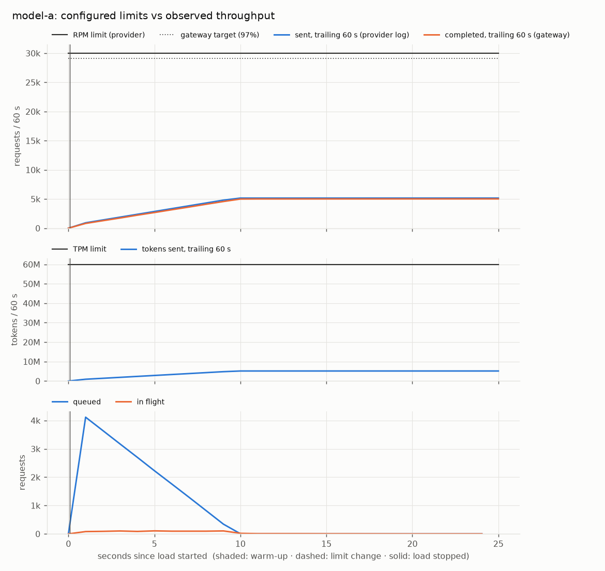
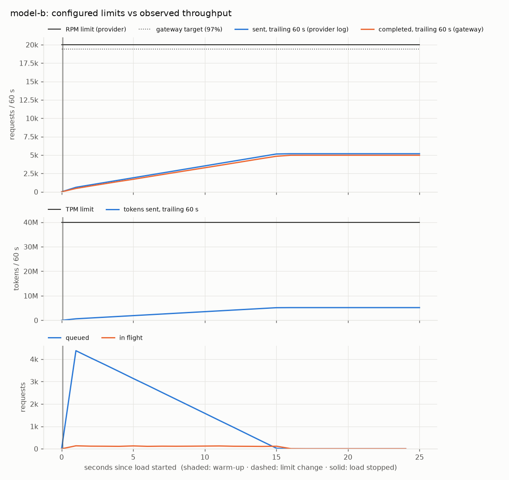
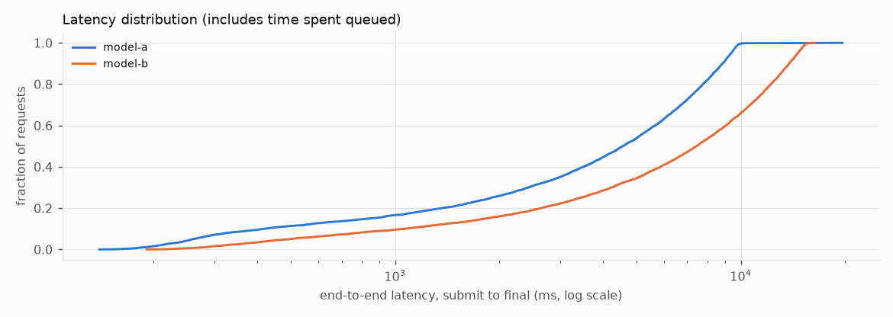

# scenario3: PASS

Asynchronous batch completion. One batch of 10,000 requests across two models with a callback URL. The simulator injects transient failures (503s and timeouts) and permanent failures (400/413); the callback receiver rejects the first two delivery attempts. Pass: ack within 1 s; callback only after every request is final; delivery succeeds after the receiver recovers; the callback summary equals GET /v1/batches/{id}; every request id appears exactly once in the results.

## Checks

| Check | Result | Evidence |
|---|---|---|
| `limits:model-a` | PASS | 5,166 counted calls; peak trailing-60s use 17.2% of RPM, 8.6% of TPM; 0 violations |
| `limits:model-b` | PASS | 5,181 counted calls; peak trailing-60s use 25.9% of RPM, 13.0% of TPM; 0 violations |
| `accounting` | PASS | submitted 10,000 = accepted 10,000 + rejected 0 (+ invalid 0, transport errors 0); snapshot_load_end: completed 0, waiting 10,000, expired 0, rejected 0, total 10,000; snapshot_drained: completed 10,000, waiting 0, expired 0, rejected 0, total 10,000; 10,000 request rows persisted |
| `ack:b_b4525305ca8347f9ab74` | PASS | acknowledged in 79 ms (limit 1000 ms) |
| `callback_after_final:b_b4525305ca8347f9ab74` | PASS | last request final at 19.715s, first callback attempt at 19.720s (+6 ms) |
| `callback_retry:b_b4525305ca8347f9ab74` | PASS | answers [503, 503, 200] at +[0.0, 1.04, 2.98]s after the first attempt; identical body: True; same event id: True |
| `callback_matches_api:b_b4525305ca8347f9ab74` | PASS | callback summary equals GET /v1/batches/{id}: status=completed_with_failures, total=10000, succeeded=9900, failed=100, expired=0 |
| `results_exactly_once:b_b4525305ca8347f9ab74` | PASS | 10,000 result rows, 10,000 unique ids, batch total 10,000, same set as submitted |

## Measured

- Load: 10,000 req/s offered for 1 s, batch size 10000, 1,000 tokens per request, models {'model-a': 0.5, 'model-b': 0.5}
- Requests: submitted 10,000, accepted 10,000, rejected 0, invalid 0, errors 0
- Completed 10,000 requests (succeeded or failed) by t=19.7 s: 507.2 requests/s (30,432/min) averaged from the start of the load to the last completion
- Submission ack latency (client side): p50 79.369 ms, p99 79.369 ms
- End-to-end latency, submit to final, all models: p50 5731.3 ms, p95 13787.0 ms, p99 15128.9 ms

| Model | Configured RPM / TPM | Peak sent in any 60 s window (requests / tokens) | Provider 429s | p50 / p95 / p99 latency (ms) |
|---|---|---|---|---|
| model-a | 30,000 / 60,000,000 | 5,166 / 5,166,000 | 0 | 4549.2 / 9372.1 / 9809.4 |
| model-b | 20,000 / 40,000,000 | 5,181 / 5,181,000 | 0 | 7439.9 / 14607.6 / 15324.1 |

## Charts

## Assumptions (simulation, not measurement)

- The provider is simulated (`python -m simulator`): latency is log-normal fitted to the configured p50/p99, and failure outcomes are drawn deterministically from a seeded hash of each request's idempotency key and attempt.
- The provider counts **estimated** tokens when it admits a call. Rate-limited (429) calls don't use capacity.
- Limits are checked at every call the provider counted, over the trailing 60 s, against the limit in effect at that moment (docs/ARCHITECTURE.md §4.1).
- Latency is end to end: it includes time spent queued, which dominates whenever demand exceeds capacity.
- Environment: {'python': '3.13.3', 'platform': 'macOS-27.0.1-arm64-arm-64bit-Mach-O', 'machine': 'arm64', 'cpus': 12, 'processor': 'arm'}
